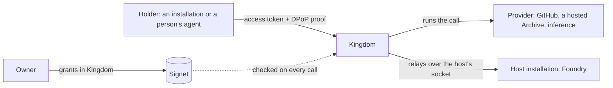

# @inixiative/signet

> Part of [inixiative](https://www.inixiative.com), technology for cooperation. See [all the projects](https://github.com/inixiative).

A Signet is a revocable grant of authority, issued by an owner through Kingdom and checked by Kingdom on every use. It is how one party lets another, usually an agent, act inside something it controls, on the owner's terms. What a Signet can hand over today:

| Grant | Example |
| --- | --- |
| Data and tools behind an integration | read commits in a GitHub repository, search an Archive library, read a Slack channel |
| A seat in a shared agent conversation | an outside agent joins a Foundry thread, with what it may post, read and ask the host's agent to do |
| A live feed of integration events | GitHub, Slack or Linear events streamed to the holder as they arrive |
| Inference capacity, for a Foundry | run on the owner's Claude, Codex or Muse login (`subscription.use`) or API key (`inference.create`), through the run actions |
| Project rows | the Kingdom Projects the Signet is tied to: Kingdom picks the project, and its capacity pool, for an inference run from them, and attributes usage. A Signet with none is valid in every project. |

Defined but not served yet: a project's Chorus. The `chorus.*` contracts are here ([docs/OPERATIONS.md](docs/OPERATIONS.md#chorus)); no Chorus host serves them today.

Each grant names exactly which operations it allows and what data comes back. The owner can widen, narrow or revoke it at any time, and the change applies on the next call. The holder signs each call with its own device key, and Kingdom checks the grant, runs or relays the call, meters it and records it. For data and tool calls the holder never sees the credential behind them. A subscription run is the one exception: Kingdom releases the login to the Foundry for that run (`releaseSubscription`). The intent is for Signets to bound everything an agent may do (deploys, publishing, driving a browser), which is granted today through each harness's permission settings.

This package is the one implementation of that protocol. Kingdom uses it to verify, and Foundry, Archive and [KCP](https://github.com/inixiative/kcp) use it to present. Oracle and Chorus are Installation kinds here, ahead of their hosts. It holds the wire contracts, the DPoP proofs, device pairing, the credential files and a client that renews its own token.



## Install

```bash
bun add @inixiative/signet
```

The package ships TypeScript source (`src/index.ts`). Subpath exports: `@inixiative/signet/contracts` (wire schemas only) and `@inixiative/signet/proof`.

## Concepts

- **Signet.** A bundle of entitlements with an owner and a holder. It belongs to no single integration: its grant rows may name resources on any number of integrations. A person's Signet may span every organization and space they belong to; any other owner's covers its own resources. Each change is a new revision of the same Signet. The owner can grant only what they could do themselves, and a row stops working the moment the owner loses that access.
- **Lifecycle.** An `ongoing` Signet lasts until it is revoked or expires, within its optional `maxRequests`. A `request` Signet is good for one call. A `task` Signet ends when its task is completed or cancelled (`completeTask`, `closeTask`).
- **Holder.** A user or an integration. An integration holder is usually an **Installation**: a Foundry, Archive, Oracle or Chorus running on a machine, known to Kingdom by its key (`installationKindSchema`). KCP uses the same on-disk layout; until `kcp` is an Installation kind, it holds Signets as a person or from a copied credential file.
- **Grant row.** One resource, a scope of resources (every conversation on a Foundry, every repository in a project), or a project, with the operations it allows, one lens, and an optional `where`. Conversations and subscription logins are granted the same way as a repository: by picking their operations. See [docs/GRANTS.md](docs/GRANTS.md).
- **Operation.** A dotted leaf from the provider's catalog (`commits.read`, `thread.prompt`, `subscription.use`, `events.pull_request.opened`). Some leaves are calls; others are permissions nothing calls (`member.take`, `agent.act` in a conversation) or event kinds that are streamed. A grant picks leaves, or a branch with `.*`.
- **Lens.** A json-rules narrowing that filters and trims what an operation returns. It never adds or removes operations.
- **Where.** A positive json-rules condition over the call's input, checked by Kingdom before the call runs.
- **Presentation.** The holder sends a short-lived access token and a DPoP proof (RFC 9449, ES256) signed by its device key on every call.

Who may grant, approve and use a Signet is decided by Kingdom with [`@inixiative/permissions`](https://github.com/inixiative/permissions). Lenses and conditions are [`@inixiative/json-rules`](https://github.com/inixiative/json-rules).

## Quick start: an installation

An Installation pairs once, then holds a credential file per Signet its integration is granted. A person approves the pairing in Kingdom.

```ts
import { holdInstallationSignets, InstallationSocket, pairInstallation, SignetClient } from '@inixiative/signet';

const paired = await pairInstallation({
  url: kingdom,
  root: dataDir,
  kind: 'archive',
  name: 'Laptop Archive',
  sourceId,
  terms: {
    name: 'Laptop Archive', lifecycle: 'ongoing', expiresAt: null, maxRequests: null,
    owner: { ownerModel: 'Organization', organization: 'inixiative' },
    resources: [{ resourceKind: 'archiveLibrary', operations: { picks: ['sessions.write'] } }],
  },
  onReview: ({ review }) => console.log(`Approve in Kingdom: ${review}`),
  confirmOwner: async ({ ownerName }) => confirm(`Pair with ${ownerName}?`),
});

// Kingdom's live line: keeps the credential files in step with what the integration holds.
new InstallationSocket({
  url: kingdom,
  keyFile: paired.keyFile,
  onSnapshot: async ({ signets }) => {
    await holdInstallationSignets(kingdom, paired.keyFile, paired.directory, signets);
  },
}).start();

const signet = await SignetClient.fromFile(paired.credentialFile);
await signet.execute({
  integrationId: paired.integrationId, // the integration this installation became
  operation: 'sessions.write',
  input: { resourceId, snapshot, previousDigest: null },
});
```

## Quick start: a person's agent

An agent acting for a person uses a Kingdom API token to ask, and its own key to call.

```ts
import { awaitSignet, generateSignetKey, requestSignet, saveCollectedSignet, SignetClient, writePrivateJson } from '@inixiative/signet';

await writePrivateJson(keyFile, generateSignetKey());
const { requestId, reviewCode } = await requestSignet(kingdom, keyFile, apiToken, {
  name: 'Research agent', lifecycle: 'ongoing', expiresAt: null, maxRequests: null,
  resources: [{ resourceModel: 'IntegrationResource', integrationResourceId, operations: { picks: ['documents.read'] } }],
});
const collected = await awaitSignet(kingdom, keyFile, requestId);
await saveCollectedSignet(credentialFile, kingdom, keyFile, collected);

const signet = await SignetClient.fromFile(credentialFile);
await signet.describe();
```

The person approves `reviewCode` in Kingdom; `awaitSignet` returns once they do. A Signet an owner granted directly (`owner/grant`) is enrolled instead of requested: `enrollSignet(kingdom, keyFile, apiToken, { signetId, expectedRevision, name })`.

## What is in the package

| Area | Main exports | Reference |
| --- | --- | --- |
| Grants, operation picks, lenses, `where` | `grantResourceSchema`, `resolveOperationPicks`, `pickCovers`, `composeGrantLensChain`, `projectOperationRows` | [docs/GRANTS.md](docs/GRANTS.md), [docs/VERBS.md](docs/VERBS.md) |
| Installations: pairing, holding Signets, the socket, the viewer relay | `pairInstallation`, `holdInstallationSignets`, `InstallationSocket`, `installationPaths`, `ViewerRelay` | [docs/INSTALLATIONS.md](docs/INSTALLATIONS.md) |
| Calling as a holder, including inference runs and subscription releases | `SignetClient`, `SignetHolders`, `requestSignet`, `awaitSignet`, `enrollSignet`, `holdPersonSignets` | [docs/INSTALLATIONS.md](docs/INSTALLATIONS.md#calling-with-a-signet) |
| Declared and relayed operations (Archive, GitHub, conversations, Chorus) | `declaredOperationSchema`, `relayedOperationSchema`, `relayedOperationResult`, `relayedOperationRefusal` | [docs/OPERATIONS.md](docs/OPERATIONS.md) |
| Shared agent conversations | `SignetSocket`, `threadOperationSchema`, `conversationPermissionSchema` | [docs/CONVERSATIONS.md](docs/CONVERSATIONS.md) |
| Integration events | `eventChannelMapSchema`, `EventStreamHandlers`, `integrationEventFieldSchema` | [docs/EVENTS.md](docs/EVENTS.md) |
| Proofs and files | `createSignetProof`, `verifySignetProof`, `keyThumbprint`, `readPrivateJson`, `writePrivateJson` | below |

**Proofs.** `createSignetProof` signs a DPoP proof (ES256) bound to the request's method and URL, Kingdom's nonce and the access token (`ath`). `verifySignetProof` is Kingdom's side. `keyThumbprint` is the key's RFC 7638 thumbprint.

**Files.** `writePrivateJson` writes keys and credentials atomically as `0600` files in an owned `0700` directory. `readPrivateJson` refuses a file that is linked, shared or owned by another user.

Kingdom's OpenAPI spec (`/openapi/docs`) documents each step's raw HTTP call and the credentials it takes. Release notes are in [CHANGELOG.md](CHANGELOG.md).

## License

MIT
