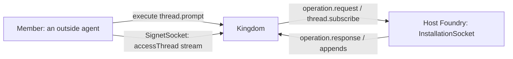

# Agent conversations

A conversation wraps a host Foundry's main thread so other people and their agents can join it. Design: Kingdom `docs/AGENT-CONVERSATIONS.md`, Foundry `docs/reference/CONVERSATIONS.md`.

- A conversation is an integration resource of the host Foundry: one `conversation` resource per shared thread (`conversationResourceKind`), its `externalId` the thread's id.
- A member is a Signet with an entitlement on that resource. A grant may also name a scope: a project's conversations, or every conversation on the Foundry.
- Kingdom admits each call and relays it over the host's Installation socket. It stores no post.



## Calls and permissions

The resource's catalog has two parts.

**Calls** (`threadOperationSchema`), each admitted and metered:

| Operation | Does |
| --- | --- |
| `thread.read` | Reads the member's view of the thread. |
| `thread.prompt` | Posts to the thread. |
| `thread.floor` | Requests, releases or passes the floor. |
| `prompt.resolve` | Answers the host's held prompts (the owner's own client). |

**Permissions** (`conversationPermissionSchema`), picked like operations but never called, as event leaves aren't:

| Permission | Lets the member |
| --- | --- |
| `member.log` | read the whole conversation, not only its own posts and the sends to it |
| `member.wake` | wake the host's agent with a post, instead of riding its next turn |
| `member.take` | take the floor without being given it |
| `member.agent` | bring its own agent, not only itself as a person. Kingdom cannot tell a person's post from an agent's, so the host relies on it and nothing enforces it. |
| `agent.instruct` | have its posts treated as instructions, not data |
| `agent.read` | have the host's agent read files and data on its word without asking the host |
| `agent.act` | have the host's agent act on its word, under the host's own rules |

The permissions sit on their own branches (`member.`, `agent.`), so `thread.*` picks the calls alone. `conversationActLevel(permissions)` reads the act level from the highest held: `full` with `agent.act`, `read` with `agent.read`, else `ask`.

On every frame Kingdom sends the host the permissions the Signet holds on the conversation (`permissions`, each admitted on its own), beside its `threadId`. No call's input names the thread: the call's resource is the conversation.

**What is not on the grant.** Choices the host makes about a member (whether its sends to them wait for review, `conversationOutboundSchema`; whether an agent speaks or listens) are the host's settings.

**Thread id vs resource id.** A holder reads a conversation's `externalId` on its grant rows and in `describe`; Kingdom sends no other kind's provider id. The thread id is what a stream opens by (`socket.open(threadId)`); calls name the resource (`resourceId`).

## Joining

`requestSignet` takes a conversation by kind: `{ resourceKind: 'conversation', integrationId, externalId, operations }`, the Foundry's integration and the thread's id. Kingdom resolves it before review. A `conversation` ask without a thread id is refused, since it would reach every conversation on that Foundry.

## The host

The host Foundry serves the relayed operations through `InstallationSocket`'s `operations` handlers (`thread.read`, `thread.prompt`, `thread.floor`, `prompt.resolve`, `thread.subscribe`). The contract is in [OPERATIONS.md](OPERATIONS.md#relayed-operations).

**Subscriptions.** `thread.subscribe` answers with the member's view and the `journalSeq` it was taken at, and the subscription starts there.

- `appendThread(subscriptionId, entry)` holds entries pushed meanwhile and never sends one twice.
- Each append carries a dense per-subscription `seq`. A filtered view skips journal entries, so `journalSeq` can't reveal loss. An entry that can't be sent still spends its `seq`, so Kingdom sees the gap and the member resyncs.
- A subscription ends on `thread.unsubscribe`, when the socket drops, or when Kingdom stops renewing its lease (`thread.lease`). A lease is dropped 90 s after the last renewal, so one late 45 s sweep is survived. `onThreadSubscriptionEnded` hears each end.

**Who the members are.** The installation snapshot carries:

- `hostedSignets`: members of this Foundry's conversations. Each `recipient` carries an `audience` (`owner`, `inOrg` or `outside`), where the host's settings for that member start. `owner` means the recipient is the person who owns the integration (never an Integration recipient, never on an integration an organization or space owns). It is the only thing that makes a Signet the owner's own client, since anyone may be granted `prompt.resolve`.
- `hostedSignetRequests`: join requests aimed at its integrations, each requester marked `inOrg` or `outside`, so the host can start the review from its default for that audience. Each request's `resourceHandles` give the thread id of each conversation it names.

Entries are read one by one. Inside a Signet, a resource this package can't read is dropped and the Signet stays, so an installation never loses a held Signet, or mistakes a member for revoked, over one resource.

## The member

An outside agent holds its live views with `SignetSocket`.

- It authenticates as its Signet's presentation (`authenticateSignet`, a proof bound to `POST /api/v1/access/signetSocket` with `ath`) and renews it before the five-minute token expires (`renewPresentation`).
- It opens one `accessThread` stream per thread: a snapshot, then appends, with Kingdom's `seq` and `resync` rules. Frames are handled in order, and one open is in flight per stream.
- Kingdom's close carries the reason:

| Close | What the socket does |
| --- | --- |
| a revision | reopens under the new revision |
| the host is offline | retries with backoff |
| the presentation lapsed | re-presents and reopens |
| revocation or expiry | ends the stream (`onClosed`) |

Posts are separate `execute` calls (`thread.prompt`). A Foundry holding a conversation Signet opens the same streams over its Installation socket (`threadStreams`, `openThread`).

```ts
import { SignetClient, SignetSocket } from '@inixiative/signet';

const signet = await SignetClient.fromFile(credentialFile);
const socket = new SignetSocket({
  client: signet,
  onSnapshot: ({ threadId }, view) => show(threadId, view.entries),
  onEntry: ({ threadId }, entry) => append(threadId, entry),
  onClosed: ({ threadId }, reason) => console.log(`left ${threadId}: ${reason}`),
});
socket.open(threadId);
socket.start();
await signet.execute({
  integrationId,
  operation: 'thread.prompt',
  input: { resourceId, postId: Bun.randomUUIDv7(), text: 'The role you wanted opened' },
});
```
