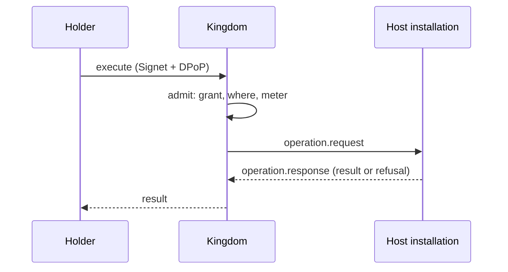

# Operations

An operation is a dotted leaf in a resource kind's catalog. Every callable operation is declared here. Kingdom runs some itself (Archive, GitHub) and relays the rest to the installation that hosts the resource (conversations, Chorus). Some leaves are never called at all: event kinds are streamed ([EVENTS.md](EVENTS.md)), and a conversation's permissions are picked like operations but only read ([CONVERSATIONS.md](CONVERSATIONS.md)).

A new operation is added here first: Kingdom's catalog, its input check and its dispatch all read these contracts.

## Declared operations

Each contract is one module per resource kind. It declares the operation enum, display names and the input each operation takes.

| Module | Resource kind | Operations |
| --- | --- | --- |
| `archive.ts` | `archiveLibrary` | `documents.read`, `documents.search`, `sessions.write`, `sessions.delete` |
| `github.ts` | `repository` | `commits.read`, `trees.read`, `blobs.read` (reads by object id) |
| `threads.ts` | `conversation` | `thread.read`, `thread.prompt`, `thread.floor`, `prompt.resolve` (relayed; see below) |
| `chorus.ts` | `chorus` | ten `chorus.*` operations (relayed; see below; no host serves them yet) |

Joining them:

| Name | Does |
| --- | --- |
| `declaredOperationSchema` | Every declared operation. Names are unique across contracts. |
| `operationInputSchemas` | Each operation's input. |
| `operationInputKeys(operation)` | The `access/execute` keys an operation takes besides `resourceId` and `limit`. |
| `operationInputFromAccess(operation, input)` | Picks and parses exactly those keys. |

### Archive

- `archiveSourceOperations` (`sessions.write`, `sessions.delete`) are a paired local Archive acting on its own sessions. Kingdom binds them to the Archive's `sourceId`, so their grant takes no lens.
- `validateArchiveOperationLens(operation, grant)` returns json-rules' `{ ok, errors }` for whether a grant can carry its lens. Search needs content over every document: no `where` at its branch, and `content` shown there. Each error is at the operation, with code `invalid_lens`.
- `validateArchiveGrantLens(scope, grant)` validates a whole row.

### GitHub

A grant pins commits on both sides: a `where` over the call's `objectId` (what may be asked) and a lens pin over the `RepositoryCall` rows' `sha` (what comes out). Reading a commit never reaches its tree, so `validateRepositoryOperationLens(operation, grant)` fails `trees.read` and `blobs.read` when the lens filters their branch. `validateRepositoryGrantLens(scope, grant)` validates a row.

## Relayed operations

For a resource hosted on an installation, Kingdom admits the call, then relays it over the host's `InstallationSocket` as one `operation.request` frame and reads its `operation.response`.

The contract is keyed by operation, beside `declaredOperationSchema`:

| Name | Holds |
| --- | --- |
| `relayedOperationSchema` | Every relayed operation (`RelayedOperation`). |
| `relayedOperationInputSchemas`, `relayedOperationContextSchemas`, `relayedOperationResultSchemas` | Input, context fields and result per operation. |
| `relayedOperationRefusals`, `relayedOperationDeniedRefusals` | The refusals each may answer, and which of them count as denied. |
| `relayedOperationCommonRefusals` | The two every operation has: `invalid_request`, `failed`. |
| `relayedOperationTimeoutMs` | How long Kingdom waits. |

**The host side.** `InstallationSocket` takes `operations`, one handler per relayed operation. A handler answers `relayedOperationResult(result)` or `relayedOperationRefusal(code, message?)` (the message is cut to 500 characters). An operation with no handler is answered `failed`. A frame this package can't read is refused `invalid_request` before any handler runs.

`OperationRequestFrame<O>` and `OperationResponseFrame<O>` keep each operation's exact context, input and result types.

### Conversations

The `thread.*` and `prompt.resolve` operations, plus `thread.subscribe`, are relayed to the host Foundry. Their context is `threadOperationContextSchema` (`member`, `threadId`, `permissions`). See [CONVERSATIONS.md](CONVERSATIONS.md).

### Chorus

Contracts only: Kingdom has the relay context for these, but no Chorus host serves them and no caller sends them yet. A `chorus` resource is one project served by a Chorus installation; its `externalId` is the Kingdom Project id, and the context is `chorusOperationContextSchema` (`projectId`). Each kind of call is its own operation, so each carries its own grant and meter.

| Operation | Asks the project's chorus to | Timeout |
| --- | --- | --- |
| `chorus.advise` | advise on a user message | 60 s |
| `chorus.guard` | guard a turn's tool activity | 60 s |
| `chorus.brief` | brief a subagent handoff | 60 s |
| `chorus.consumed` | advise on a consumed work item | 60 s |
| `chorus.milestone` | advise before a milestone call | 30 s |
| `chorus.handBack` | advise on a turn's hand-back message | 60 s |
| `chorus.review` | review finished work and update thread knowledge | 60 s |
| `chorus.conventions` | return domain conventions and instructions | 15 s |
| `chorus.debugReason` | explain why a Warden decision answered as it did | 30 s |
| `chorus.projectActivity` | start, touch, stop or report the status of its host | 15 s |

Inputs, results and refusals: `chorusInputSchemas`, `chorusResultSchemas`, `chorusRefusalSchema`, `chorusDeniedRefusals`. Size limits are exported beside them (`chorusMomentLimit`, `chorusContextLimit`, `chorusKnowledgeLimit`, `chorusAnswerTextLimit`, `chorusDomainCountLimit`, `chorusMaxDeadlineMs`).
